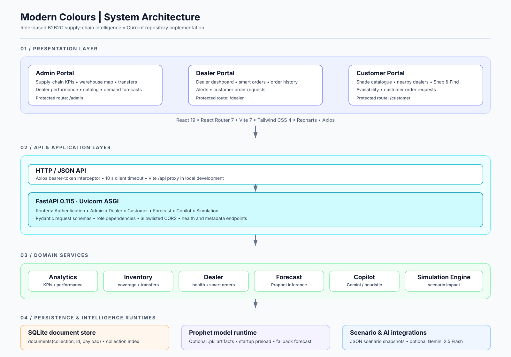
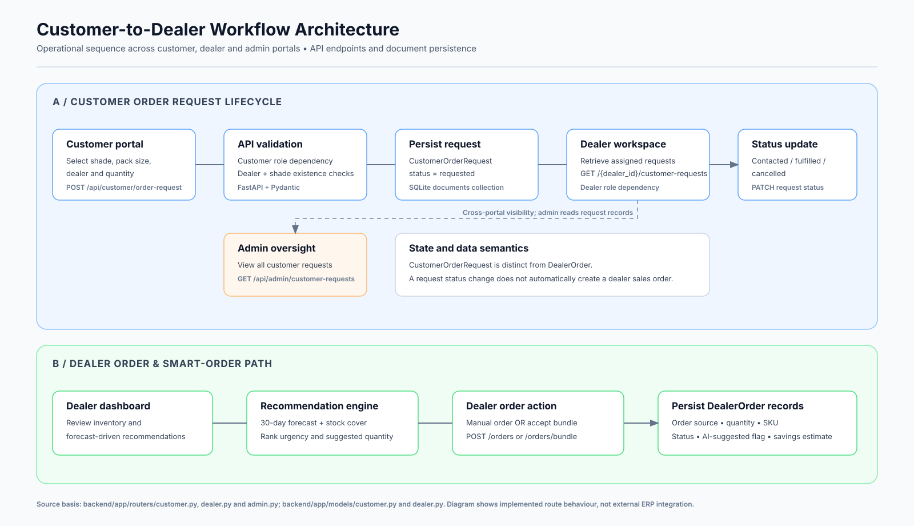
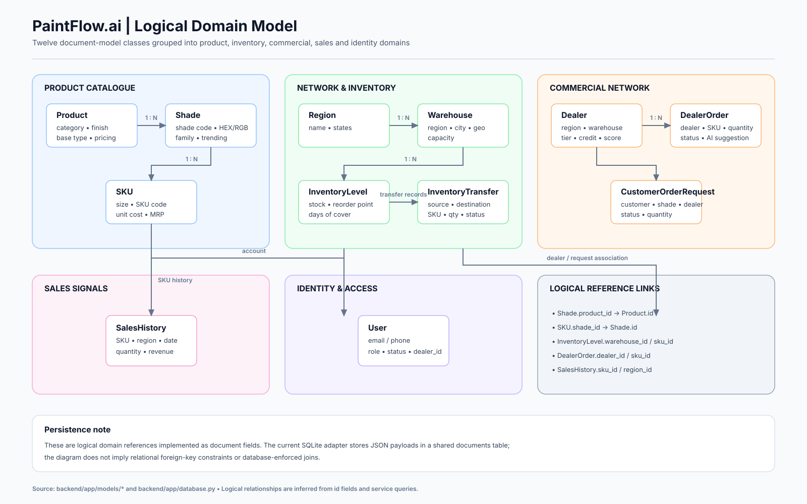
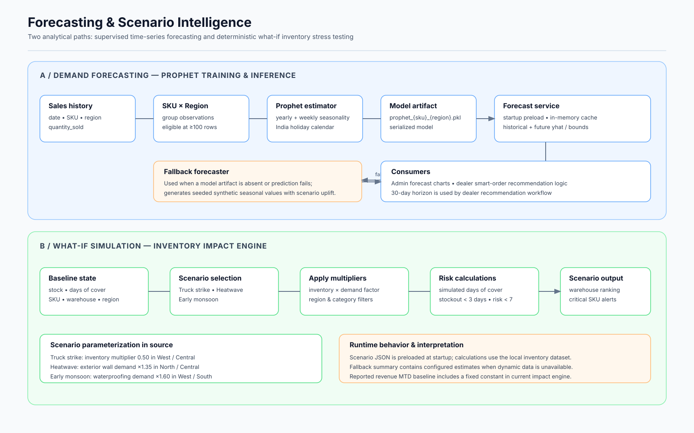
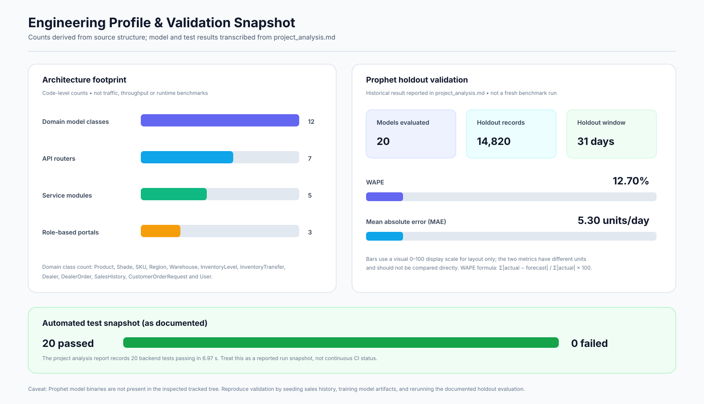

# MODERN COLOURS

  

<h3 align="center">Intelligent Manufacturing. Connected Operations.</h3>

  A full-stack supply-chain intelligence platform for paint manufacturing and distribution

  
  
  
  
  

  <strong>ONE APPLICATION · THREE ROLE-BASED PORTALS · ONE SHARED SUPPLY-CHAIN DOMAIN</strong>

---

## Contents

- [1. Product overview](#1-product-overview)
- [2. System architecture](#2-system-architecture)
- [3. Role-based application architecture](#3-role-based-application-architecture)
- [4. Domain model and persistence architecture](#4-domain-model-and-persistence-architecture)
- [5. Analytics, forecasting and simulation](#5-analytics-forecasting-and-simulation)
- [6. AI copilot and colour intelligence](#6-ai-copilot-and-colour-intelligence)
- [7. API surface and access matrix](#7-api-surface-and-access-matrix)
- [8. Security architecture](#8-security-architecture)
- [9. Technology stack](#9-technology-stack)
- [10. Engineering metrics and validation](#10-engineering-metrics-and-validation)
- [11. Repository structure](#11-repository-structure)
- [12. Local development](#12-local-development)
- [13. Configuration reference](#13-configuration-reference)
- [14. Deployment and operational considerations](#14-deployment-and-operational-considerations)
- [15. Modelling assumptions and limitations](#15-modelling-assumptions-and-limitations)

---

## 1. Product overview

**Modern Colours** is a full-stack supply-chain intelligence application for paint manufacturing and distribution. It addresses a recurring operational problem in distributed inventory networks: one warehouse can experience a stockout while another holds excess or slow-moving inventory of the same product.

The system brings three stakeholder experiences into one React application:

| Portal | Primary user | Operational responsibility |
|---|---|---|
| **Admin** | Manufacturer / supply-chain administrator | Network oversight, inventory health, transfer approvals, dealer performance and catalogue administration |
| **Dealer** | Distribution partner | Dealer performance, replenishment recommendations, sales orders and customer requests |
| **Customer** | End customer | Shade discovery, nearby dealer selection, stock availability and order requests |

The application combines role-aware user interfaces, a Python API, domain-specific business services, a persistent local data store, statistical forecasting, scenario analysis and an optional generative-AI copilot.

> **Architecture clarification:** This repository contains one React/Vite single-page application with three role-based portals and one FastAPI backend. The portals are not three separately deployed frontend applications.

### Core capability map

| Capability | What it does |
|---|---|
| Supply-chain observability | Aggregates SKU, warehouse, dealer, revenue and inventory-risk indicators |
| Inventory health | Classifies inventory by days of cover and flags critical, low and excess stock |
| Inventory rebalancing | Presents transfer recommendations and supports approval workflows |
| Demand forecasting | Uses Prophet models for SKU-region sales time series when trained artifacts are available |
| Dealer intelligence | Computes dealer health indicators and forecast-informed smart-order suggestions |
| Customer discovery | Supports shade catalogue browsing, nearby dealer discovery and availability lookup |
| Snap & Find | Extracts an approximate colour value from an uploaded image and searches the shade catalogue |
| Disruption analysis | Evaluates stock and demand shocks for selected regional scenarios |
| Supply-chain copilot | Generates contextual operational responses through Gemini or a deterministic fallback |

## 2. System architecture

The following C4-inspired component view represents the source implementation: browser presentation, API boundary, application services and persistence / intelligence dependencies.

  

### 2.1 Architectural layers

| Layer | Technology / implementation | Responsibility |
|---|---|---|
| Presentation | React 19, React DOM, React Router 7 | Role-specific pages, route composition and rendering |
| Client state | React Context | Authentication and scenario selection state |
| HTTP transport | Axios | JSON requests, bearer-token attachment and response interception |
| Local development gateway | Vite proxy | Routes browser requests under /api to the local FastAPI server |
| API runtime | FastAPI 0.115, Uvicorn | HTTP routing, dependency injection, CORS and lifecycle hooks |
| Schema validation | Pydantic 2 | Typed request payloads and validation |
| Domain layer | Python service modules | Analytics, inventory, dealer, forecasting and copilot logic |
| Persistence | SQLite + custom document adapter | Collection-scoped JSON document storage |
| Forecast runtime | Prophet + serialized model artifacts | SKU-region time-series inference when model files are present |
| Scenario runtime | Python impact engine + JSON snapshots | Inventory stress testing and scenario-specific risk indicators |
| External AI | Google Gemini API (optional) | Context-grounded copilot response generation |

### 2.2 Request lifecycle

1. A user opens a role-specific route in the React application.
2. AuthProvider restores the client session; protected routes enforce the expected role in the interface.
3. Axios sends an HTTP request to the /api namespace and attaches the bearer token when present.
4. FastAPI dispatches the request to the relevant router.
5. Router dependencies validate the current user and required role.
6. The router invokes a domain service and obtains a database session through get_db.
7. The service reads or mutates domain documents and returns JSON.
8. The frontend renders the response through page components, charts, maps and operational cards.

The Vite proxy is a **development-time** convenience. It is not itself a production API gateway.

### 2.3 Component dependency map

| API router | Main service dependencies | Primary output |
|---|---|---|
| /api/admin | Analytics and inventory services | Dashboard summaries, inventory views, transfer actions and dealer metrics |
| /api/dealer | Dealer service and forecast service | Dealer metrics, smart orders, alerts and order workflows |
| /api/customer | Product, dealer and inventory domain queries | Shade catalogue, availability and customer order requests |
| /api/forecast | Forecast service | Historical and predicted sales series |
| /api/copilot | Copilot and inventory services | Text response and allowlisted UI widget |
| /api/simulate | Scenario service and impact engine | Scenario definitions and impact summaries |
| /api/auth | Authentication and user models | Registration, login, identity and account lifecycle operations |

## 3. Role-based application architecture

| Role | Frontend route | Principal capabilities |
|---|---|---|
| Admin | /admin | Dashboard KPIs, catalogue, forecasts, dead stock, warehouse transfers, dealer analytics and customer-request oversight |
| Dealer | /dealer | Dealer dashboard, smart orders, order placement, order history, alerts and customer requests |
| Customer | /customer | Shade catalogue, shade details, nearby dealers, availability, Snap & Find and customer order requests |

### 3.1 Admin workspace

- Supply-chain summary metrics: SKU count, warehouse count, dealer count, revenue, stockouts, pending transfers, revenue at risk and dead stock.
- Warehouse map with inventory status and capacity utilization.
- SKU-level warehouse inventory inspection.
- Recommended inventory transfers and approval actions.
- Dealer performance ranking and top-selling SKU analysis.
- Product and shade catalogue administration.
- Customer-request oversight and SKU demand forecasts.

### 3.2 Dealer workspace

- Dealer-specific dashboard and health score.
- Forecast-informed smart-order recommendations.
- Manual order placement and bulk acceptance of eligible AI-suggested recommendations.
- Order history and alert views.
- Customer order-request handling for the dealer.

### 3.3 Customer workspace

- Product and shade catalogue browsing.
- Shade details, colour family and product information.
- Nearby-dealer lookup and shade availability.
- Image upload and colour extraction through **Snap & Find**.
- Customer order requests and order history.

### Cross-portal order lifecycle

The workflow below distinguishes a customer purchase request from a dealer sales order. They are separate domain records and follow separate API paths.

  

## 4. Domain model and persistence architecture

The domain model contains twelve document-model classes grouped across product catalogue, inventory network, commercial operations, sales signals and user identity.

  

### 4.1 Domain entities

| Domain | Entity | Principal attributes / responsibility |
|---|---|---|
| Product catalogue | Product | Category, sub-category, base type, finish, pack sizes and price per litre |
| Product catalogue | Shade | Shade code/name, HEX and RGB values, family, trending flag and product association |
| Product catalogue | SKU | Pack size, SKU code, unit cost, MRP and shade association |
| Network | Region | Region name and associated states |
| Network | Warehouse | Region, city, state, latitude/longitude and storage capacity |
| Inventory | InventoryLevel | Warehouse/SKU stock, reorder point, maximum capacity and days of cover |
| Inventory | InventoryTransfer | Source warehouse, destination warehouse, SKU, quantity, status and rationale |
| Channel | Dealer | Region, warehouse, location, tier, credit limit and performance score |
| Channel | DealerOrder | Dealer, SKU, quantity, status, source, AI-suggested flag and savings estimate |
| Sales | SalesHistory | SKU, region, date, quantity sold, revenue and channel |
| Customer | CustomerOrderRequest | Customer contact, shade, size, dealer, quantity, status and timestamp |
| Identity | User | Email/phone, password hash, role, account status, dealer association and verification/reset state |

### 4.2 SQLite document-store implementation

The persistence layer in backend/app/database.py uses Python's standard-library sqlite3 module. It is a lightweight document adapter, not SQLAlchemy and not a normalized relational schema.

The physical table is:

~~~sql
CREATE TABLE documents (
    collection TEXT NOT NULL,
    id         INTEGER NOT NULL,
    payload    TEXT NOT NULL,
    PRIMARY KEY (collection, id)
);

CREATE INDEX idx_documents_collection
    ON documents(collection);
~~~

Each model declares a collection name. Model instances are serialized to JSON in payload; the adapter restores Python date/datetime values when documents are read. Queries first select payloads for a collection and then apply the adapter's filter, sort and limit operations in Python.

**Architectural consequences**

- Entity links such as sku_id, warehouse_id and dealer_id are logical references in JSON documents.
- The current storage schema does not define relational foreign-key constraints.
- Collection reads deserialize matching documents before in-memory filtering and sorting.
- The collection index narrows the initial table scan by collection, but it does not index every field inside JSON payloads.
- SQLite is file-backed at backend/data/modern_colours.db by default; the path can be overridden with DATABASE_PATH.

This design keeps the application compact and straightforward to run locally. For higher write concurrency, multi-instance deployment or large collections, evaluate a relational database and indexed query layer before scaling the workload.

## 5. Analytics, forecasting and simulation

The application has two distinct analytical paths: statistical time-series forecasting and deterministic what-if inventory stress testing.

  

### 5.1 Demand forecasting — Prophet

The forecasting pipeline groups historical sales by **SKU × region** and trains a Prophet model for combinations with at least 100 observations.

| Parameter | Configuration |
|---|---|
| Yearly seasonality | Enabled |
| Weekly seasonality | Enabled |
| Daily seasonality | Disabled |
| Changepoint prior scale | 0.05 |
| Country holiday calendar | India |
| Minimum observations per SKU-region pair | 100 |
| Model artifact convention | prophet_{sku_id}_{region_id}.pkl |

At backend startup, forecast_service.preload_models() attempts to load serialized model files into an in-memory cache. A forecast request returns historical values and future predictions, including yhat, lower-bound and upper-bound fields.

The dealer smart-order workflow requests a 30-day forecast and uses projected demand in its recommendation calculation.

**Fallback behaviour:** When the expected model artifact is missing or prediction fails, the service creates a deterministic, seeded synthetic seasonal series. It includes a configured October uplift. This is a resilience/demo fallback and must not be interpreted as a trained-model prediction.

### 5.2 Inventory health and replenishment logic

The application uses *days of cover* to estimate how long current inventory can satisfy demand.

\[
\text{Daily Demand} =
\frac{\text{Current Stock}}{\max(\text{Days of Cover},\,0.1)}
\]

| Condition | Rule | Interpretation |
|---|---:|---|
| Critical | Days of cover < 3 | Immediate stockout risk |
| Low | 3 ≤ days of cover < 14 | Replenishment attention |
| Healthy | 14–90 days | Normal operating band |
| Overstock / dead stock | Days of cover > 90 | Excess cover / capital tied up |

For revenue-at-risk estimation, inventory levels below seven days of cover contribute a projected deficit over the remaining portion of a seven-day window:

\[
\text{Risk} =
\text{Daily Demand}
\times \max(0,\,7-\text{Days of Cover})
\times \text{SKU MRP}
\]

The estimate is an operational heuristic based on stored cover and SKU MRP; it is not an observed realized loss.

### 5.3 Dealer health score

The dealer service computes a weighted score on a 0–100 scale:

\[
H = 0.40C + 0.25S + 0.20F + 0.15B
\]

Where:

- C = stock-coverage score, scaled against 30 days of average cover and capped at 100.
- S = stockout score, reduced by 15 points per SKU below the three-day threshold and floored at zero.
- F = order-fulfilment percentage, measured as delivered orders / total orders.
- B = product-breadth score, scaled against 20 unique ordered SKUs and capped at 100.

The weights are implementation constants in dealer_service.py, not learned model coefficients.

### 5.4 Smart-order recommendation logic

For each low-cover SKU considered by the dealer service:

\[
\text{Recommended Quantity} =
\max\left(10,\left\lfloor1.2\times\text{Forecast Demand}-\text{Current Stock}\right\rfloor\right)
\]

The service labels urgency based on cover:

- **CRITICAL:** less than three days.
- **RECOMMENDED:** less than fourteen days.
- **OPTIONAL:** fourteen days or more within the considered candidate set.

The current savings estimate applies an 8% reduction to the manual-price baseline. This is a deterministic estimate in the service code, not a measured causal saving or a separately trained optimization model.

### 5.5 What-if disruption scenarios

The simulation impact engine evaluates inventory under three configured disruptions:

| Scenario | Affected regions | Product scope | Configured shock |
|---|---|---|---|
| Truck Strike | West, Central | All categories | Available inventory × 0.50 |
| Heatwave | North, Central | Exterior Wall | Demand × 1.35 |
| Early Monsoon | West, South | Waterproofing | Demand × 1.60 |

For each inventory record, the engine derives baseline daily demand from stock and days of cover, applies scenario multipliers where the region/category matches, and calculates simulated days of cover.

- Simulated cover below three days increments the stockout count.
- Simulated cover below seven days contributes to revenue at risk.
- Warehouse impacts are ranked by critical SKU count and estimated revenue at risk.
- Critical SKU alerts are returned for the affected scenario.

Scenario snapshots are loaded from JSON at application startup. If scenario data cannot be loaded or calculated, the scenario module has a configured fallback summary.

**Modelling caveat:** Some scenario summary fields still use fixed assumptions in the current source, including the MTD revenue baseline and an additional emergency-transfer allowance for a strike. Inventory-cover and SKU-risk calculations are data-derived, but not every dashboard field is a live forecast.

## 6. AI copilot and colour intelligence

### 6.1 Supply-chain copilot

The copilot is available to admin and dealer roles. It builds a text snapshot from warehouse inventory status, then requests a structured response from the configured Gemini model.

- Default model setting: gemini-2.5-flash.
- Provider integration: google-genai Python SDK.
- Response format: JSON with a text response and optional UI widget.
- Allowed widget types: TRANSFER_CARD and INSIGHT_CARD.
- Widget properties are sanitized to primitive scalar values or bounded primitive lists.
- Gemini calls execute through a worker thread and are bounded by a configurable timeout.
- When the API key is absent or the call fails/times out, a local heuristic response is returned.

The copilot prompt instructs the model to use only the supplied inventory context. The heuristic fallback is deterministic and should not be represented as a language-model answer.

### 6.2 Snap & Find

The customer-side image workflow performs colour extraction in the browser:

1. The uploaded image is drawn to a canvas.
2. A central 24 × 24 pixel patch is sampled.
3. The RGB channels are averaged across the patch.
4. The average is converted to a hexadecimal colour value.
5. The colour value is sent to the backend shade-matching endpoint.
6. The matched shade can be followed by a nearby-dealer availability lookup.

This is an image-based colour-sampling workflow. It does not currently implement a trained computer-vision model, semantic wall segmentation, illuminant correction or calibrated colour measurement. Ambient light, camera processing, gloss, shadows and display calibration can affect the extracted colour.

## 7. API surface and access matrix

The FastAPI application registers seven routers.

| Router | Prefix | Role dependency | Primary operations |
|---|---|---|---|
| Authentication | /api/auth | Public entry points; admin-protected approval actions | Registration, login, current-user lookup, verification/reset flows and dealer approval |
| Admin | /api/admin | Admin | Dashboard summary, warehouse map/detail, dead stock, transfer recommendations/approval, dealer performance, top SKUs, catalogue and customer requests |
| Dealer | /api/dealer | Dealer | Dashboard, smart orders, manual/bundled orders, history, alerts and customer-request status |
| Customer | /api/customer | Customer | Shade catalogue/detail, availability, nearby dealers, Snap & Find, order requests and order history |
| Forecast | /api/forecast | Admin and Dealer | SKU forecast and regional summary |
| Copilot | /api/copilot | Admin and Dealer | Context-aware copilot chat |
| Simulation | /api/simulate | Admin and Dealer | Scenario list and scenario impact data |

### Operational endpoints

| Endpoint | Purpose |
|---|---|
| GET /api/health | Process health response |
| GET /api/meta | Configured simulation date, scenario identifiers and model-version metadata |
| GET /docs | Interactive FastAPI OpenAPI documentation |
| GET /redoc | ReDoc API reference |

### Representative route families

- /api/admin/dashboard/summary
- /api/admin/inventory/map
- /api/admin/inventory/warehouse/{warehouse_id}
- /api/admin/transfers/recommended
- /api/admin/transfers/{transfer_id}/approve
- /api/dealer/{dealer_id}/dashboard
- /api/dealer/{dealer_id}/smart-orders
- /api/dealer/{dealer_id}/orders
- /api/customer/shades/{shade_id}
- /api/customer/shades/{shade_id}/availability
- /api/customer/order-request
- /api/forecast/{sku_id}
- /api/copilot/chat
- /api/simulate/scenarios
- /api/simulate/scenario/{scenario_id}/data

The route table is representative, not a replacement for the generated OpenAPI schema at /docs.

## 8. Security architecture

The current implementation includes the following controls:

| Control | Implementation |
|---|---|
| Password storage | Salted scrypt password derivation (N=2^14, r=8, p=1, dklen=64) |
| Access tokens | Signed bearer token using HMAC-SHA256 / HS256 format |
| Token lifetime | Eight hours |
| Role authorization | FastAPI dependencies using require_roles(...) |
| Dealer onboarding | Dealer account is created in pending status until admin approval |
| Cross-origin requests | Explicit origin allowlist from ALLOWED_ORIGINS |
| Secret configuration | Production requires a JWT_SECRET of at least 32 characters |
| Copilot output | Widget-type allowlist and property sanitization |

The browser client stores the session in local storage and attaches the bearer token through an Axios request interceptor. A 401 response clears the stored session.

**Deployment hardening:** Use a unique high-entropy production secret, HTTPS, restrictive CORS origins, durable database storage, protected environment variables, and appropriate rate limiting and monitoring at the hosting layer. Do not use the development fallback secret in a production environment.

## 9. Technology stack

Versions below reflect the dependency manifests currently committed in this repository.

### 9.1 Frontend

| Technology | Version / package | Architectural role |
|---|---|---|
| React | 19.1.0 | Component and state-driven UI |
| React DOM | 19.1.0 | Browser rendering |
| Vite | 7.3.1 | Development server and production bundler |
| React Router DOM | 7.13.0 | Client-side route composition |
| Tailwind CSS | 4.1.18 | Utility-first styling |
| Axios | 1.13.4 | HTTP client and interceptors |
| Recharts | 3.7.0 | KPI and forecast visualizations |
| react-simple-maps | 3.0.0 | Geographic warehouse visualization |
| Heroicons React | 2.2.0 | UI iconography |
| canvas-confetti | 1.9.4 | Interface feedback animation |

### 9.2 Backend and data

| Technology | Version / package | Architectural role |
|---|---|---|
| Python | 3.10+ language features | Backend runtime |
| FastAPI | 0.115.0 | API framework |
| Uvicorn | 0.34.0 | ASGI server |
| Pydantic | 2.8.0 | Request validation and schemas |
| SQLite | Python standard library | Embedded persistent store |
| python-dotenv | 1.0.1 | Environment loading |
| python-dateutil | 2.9.0 | Date utilities |

### 9.3 Analytics, AI and file handling

| Technology | Version / package | Architectural role |
|---|---|---|
| Prophet | >=1.1.6, <2 | SKU-region time-series forecasting |
| CmdStanPy | >=1.2, <2 | Prophet model backend |
| Pandas | 2.2.2 | Sales time-series preparation |
| NumPy | 1.26.4 | Numerical calculations and deterministic fallback generation |
| google-genai | >=1.0, <2 | Optional Gemini API client |
| Pillow | 10.4.0 | Image-processing utility dependency |
| python-multipart | 0.0.9 | Multipart request parsing |
| aiofiles | 24.1.0 | Asynchronous file I/O |

## 10. Engineering metrics and validation

The infographic below separates source-structure counts from historical validation values. These are not production traffic or performance claims.

  

### 10.1 Source-structure counts

| Measure | Count | Counting basis |
|---|---:|---|
| Role-based portals | 3 | Admin, Dealer and Customer route trees |
| API routers | 7 | Router modules registered by backend/app/main.py |
| Domain service modules | 5 | Analytics, inventory, dealer, forecast and copilot services |
| Domain model classes | 12 | Classes exported by backend/app/models/__init__.py |

### 10.2 Historical forecasting validation snapshot

The project analysis report records the following Prophet evaluation:

| Metric | Reported value | Evaluation context |
|---|---:|---|
| Models evaluated | 20 | SKU-region Prophet models |
| Sales-history records | 14,820 | Reported evaluation dataset |
| Holdout window | 31 days | 10 Sep 2025 – 10 Oct 2025 |
| Mean WAPE | **12.70%** | Weighted absolute percentage error |
| Mean MAE | **5.30 units/day** | Mean absolute error |

Definitions:

\[
\text{WAPE} =
\frac{\sum_i |y_i-\hat{y}_i|}{\sum_i |y_i|}
\times 100
\]

\[
\text{MAE} =
\frac{1}{n}\sum_{i=1}^{n}|y_i-\hat{y}_i|
\]

These are **reported historical validation results**, not a fresh evaluation executed by this README update. The trained .pkl model artifacts are not present in the inspected tracked repository tree. Reproducing the figures requires regenerating the sales dataset, training the models and running the same holdout procedure.

### 10.3 Backend test snapshot

The project analysis report records **20 backend tests passed** with **0 failures** in a run reported at 6.97 seconds. The test suite covers authentication, role restrictions, inventory transfers, idempotency, simulation impact, customer-order workflows, forecast authorization and copilot fallback/widget sanitization.

This is a documented test-run snapshot, not a claim about a currently running CI pipeline.

## 11. Repository structure

~~~text
SE_project/
├── backend/
│   ├── app/
│   │   ├── main.py                  # FastAPI application and router registration
│   │   ├── config.py                # Environment and runtime configuration
│   │   ├── auth.py                  # Password hashing, tokens and role checks
│   │   ├── database.py              # SQLite JSON-document adapter
│   │   ├── models/                  # Twelve domain document models
│   │   ├── schemas/                 # Pydantic request schemas
│   │   ├── routers/                 # Seven API routers
│   │   ├── services/                # Analytics, inventory, dealer, forecast, copilot
│   │   ├── ml/
│   │   │   └── train_prophet.py     # SKU-region model trainer
│   │   └── simulations/
│   │       ├── impact_engine.py     # Inventory stress and risk calculations
│   │       ├── scenarios.py         # Scenario definitions and preload logic
│   │       └── data/                # Scenario JSON snapshots
│   ├── seed/                        # Catalogue, geography and sales seed data
│   ├── tests/                       # Backend automated tests
│   ├── requirements.txt
│   ├── .env.example
│   └── seed_and_train.py
│
├── frontend/
│   ├── src/
│   │   ├── App.jsx                  # Role-based route tree
│   │   ├── api/                     # Axios API clients
│   │   ├── components/              # Charts, maps, copilot and shared UI
│   │   ├── contexts/                # Authentication and simulation context
│   │   ├── layouts/                 # Admin, Dealer and Customer layouts
│   │   ├── pages/                   # Role-specific screens
│   │   └── utils/
│   ├── package.json
│   └── vite.config.js
│
├── docs/
│   └── architecture/
│       ├── system-architecture.svg
│       ├── domain-model.svg
│       ├── forecast-and-simulation.svg
│       └── engineering-metrics.svg
│
├── mark.svg
├── project_analysis.md              # Detailed implementation and validation report
├── presentation.md
└── README.md
~~~

## 12. Local development

### Prerequisites

- Python 3.10 or newer.
- Node.js and npm.
- Git.
- A Google Gemini API key only when hosted AI copilot responses are required.

### 12.1 Backend setup

From the repository root:

~~~bash
cd backend
python -m venv .venv
~~~

Activate the environment:

~~~powershell
# Windows PowerShell
.venv\Scripts\Activate.ps1
~~~

~~~bash
# macOS / Linux
source .venv/bin/activate
~~~

Install dependencies and create the local environment file:

~~~bash
pip install -r requirements.txt
~~~

~~~powershell
# Windows
copy .env.example .env
~~~

~~~bash
# macOS / Linux
cp .env.example .env
~~~

Generate a secure signing secret:

~~~bash
python -c "import secrets; print(secrets.token_hex(32))"
~~~

Set the generated value as JWT_SECRET in backend/.env. Configure GEMINI_API_KEY if Gemini responses are required. Without it, the copilot uses its local heuristic fallback.

Seed the local dataset and train eligible Prophet models:

~~~bash
python seed_and_train.py
~~~

Start the API:

~~~bash
uvicorn app.main:app --reload --host 0.0.0.0 --port 8001
~~~

The API is available at http://localhost:8001; interactive OpenAPI documentation is at http://localhost:8001/docs.

### 12.2 Frontend setup

Open a second terminal from the repository root:

~~~bash
cd frontend
npm install
npm run dev
~~~

Open http://localhost:5173. During local development, Vite forwards /api requests to http://127.0.0.1:8001.

### 12.3 Run backend tests

The backend test suite uses pytest. Install it into the backend virtual environment if it is not already available:

~~~bash
pip install pytest
~~~

Then run from the backend/ directory:

~~~bash
pytest -q
~~~

## 13. Configuration reference

The backend loads environment variables from backend/.env. The committed backend/.env.example documents the supported settings.

| Variable | Default / example | Purpose |
|---|---|---|
| ENVIRONMENT | development | Runtime mode; production mode enforces a configured JWT secret |
| JWT_SECRET | No production default | HMAC signing secret; minimum 32 characters in production |
| DATABASE_PATH | backend/data/modern_colours.db | SQLite database file path |
| APP_SIMULATION_DATE | 2025-10-10 | Narrative reference date used by forecast and scenario logic |
| GEMINI_API_KEY | Empty | Optional API key for Gemini copilot |
| GEMINI_MODEL | gemini-2.5-flash | Gemini model identifier |
| COPILOT_TIMEOUT | 3.0 | Copilot request timeout in seconds |
| ALLOWED_ORIGINS | Local frontend origins | Comma-separated CORS origin allowlist |

Never commit a populated .env file, real API keys or production signing secrets.

## 14. Deployment and operational considerations

The repository provides a local Vite development setup and a FastAPI backend. It does not currently include a Docker Compose deployment, Kubernetes manifests, Terraform configuration or a fully specified cloud hosting topology.

A production deployment therefore requires an explicit hosting design for both the static frontend and API service.

Recommended production topology:

1. Serve the compiled frontend through a static host or CDN.
2. Run FastAPI behind an HTTPS-terminating reverse proxy or managed ingress.
3. Configure the frontend API base path or reverse-proxy routing to reach the backend.
4. Store secrets in the hosting provider's secret manager rather than in source control.
5. Persist the database on durable storage; do not rely on ephemeral container filesystems.
6. Configure backups, structured logs, health checks, rate limits and monitoring.
7. Restrict CORS to the deployed frontend origin.
8. Keep the optional Gemini integration behind server-side secret handling.

### Local service topology

| Process | Default local address | Purpose |
|---|---|---|
| Vite frontend | http://localhost:5173 | React application |
| FastAPI backend | http://localhost:8001 | API and business logic |
| OpenAPI docs | http://localhost:8001/docs | API exploration |
| SQLite | backend/data/modern_colours.db | Local persistent store |

The SQLite file path and the Vite proxy target are development defaults; production values must be configured for the selected hosting environment.

## 15. Modelling assumptions and limitations

This section distinguishes implemented functionality from assumptions that should be validated before using the system for live operational decisions.

| Area | Current implementation | Interpretation / next validation |
|---|---|---|
| Database | SQLite JSON-document adapter | Suitable for a compact local deployment; validate concurrency and indexing for production scale |
| Entity relations | IDs stored inside document payloads | Logical relationships are not database-enforced foreign keys |
| Forecasting | Prophet models with deterministic synthetic fallback | Surface model-vs-fallback provenance to decision makers |
| ML artifacts | Model trainer exists; artifacts are not present in the inspected tracked tree | Train and version/publish artifacts through a reproducible pipeline |
| Scenario engine | Inventory/demand multipliers with data-derived SKU risk | Validate scenario calibration against historical disruption data |
| Scenario summaries | Some fallback and summary values use fixed assumptions | Label assumptions and replace constants with measured inputs |
| Smart-order savings | Fixed 8% estimate | Treat as indicative until validated against realized logistics and purchase costs |
| Snap & Find | Central-patch RGB averaging | Not a calibrated colourimeter or trained computer-vision model |
| Authentication | HMAC-signed bearer tokens and localStorage client session | Add operational controls such as rate limiting, token revocation strategy and secure deployment headers |
| Deployment | Local development instructions and Vite proxy | Define production hosting, persistent storage and release automation |

---

  
   
  <strong>MODERN COLOURS</strong>
   
  Intelligent Manufacturing. Connected Operations.
    
  Manufacturing intelligence · Inventory optimization · Connected distribution

