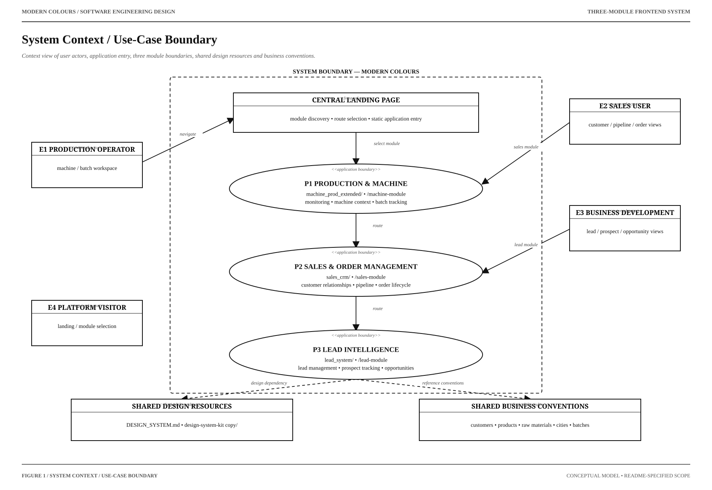
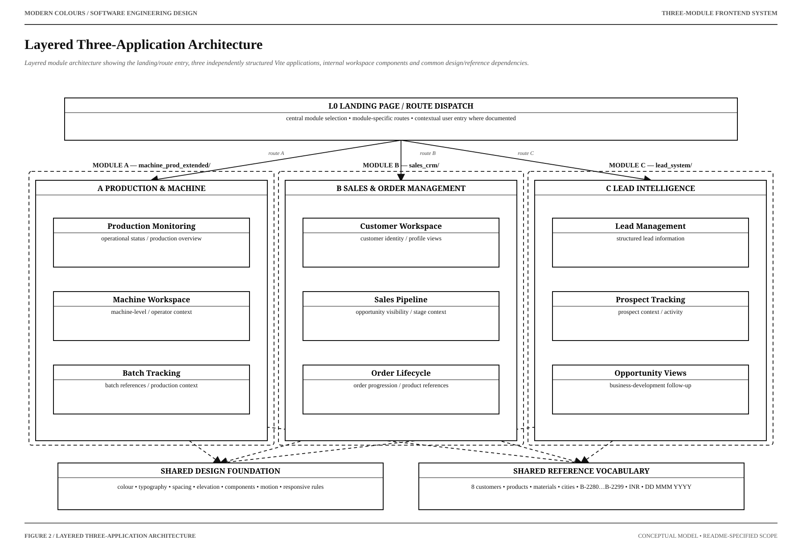
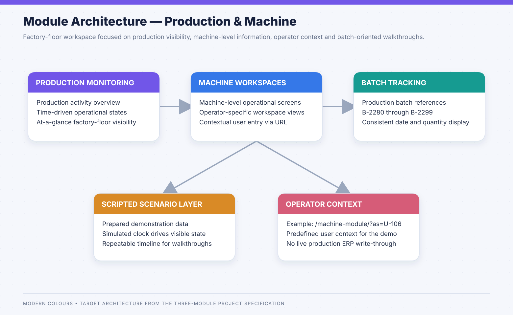
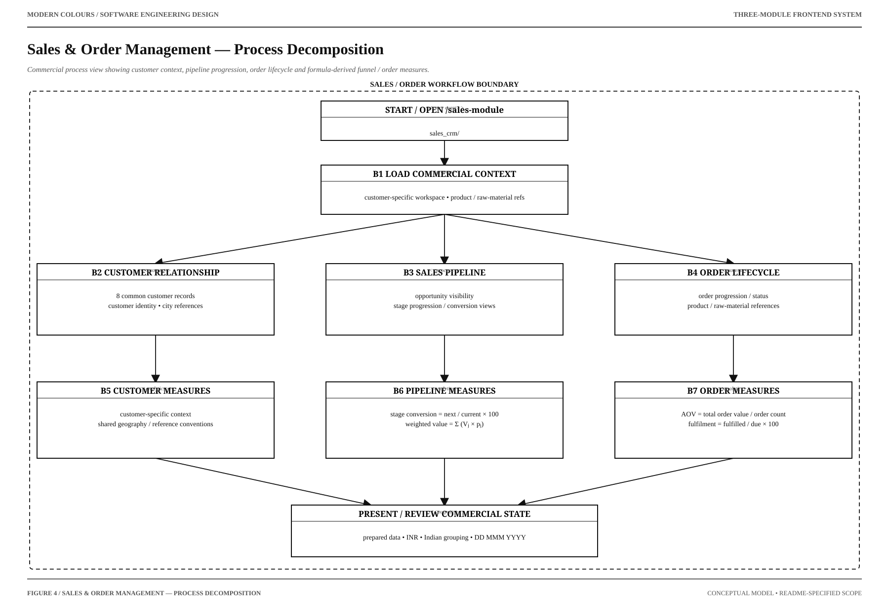
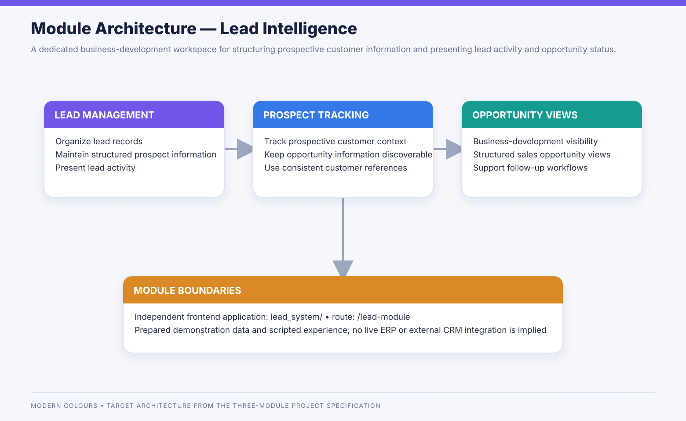
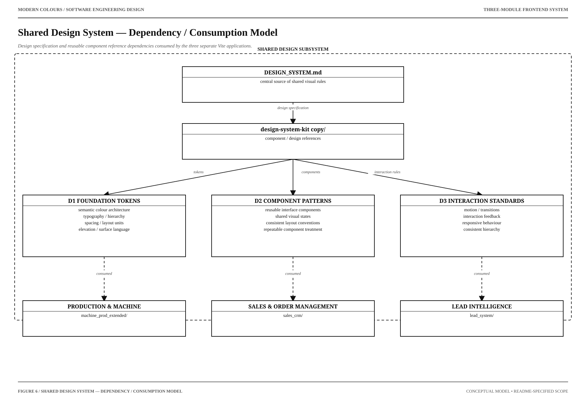
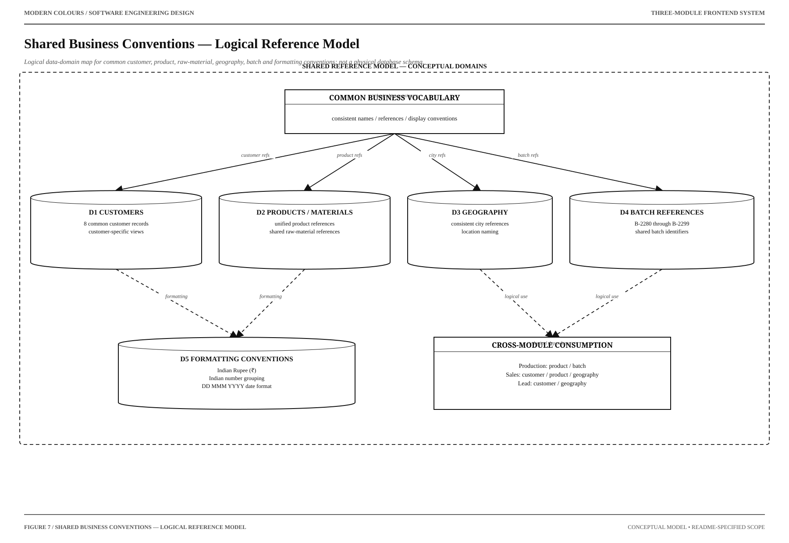
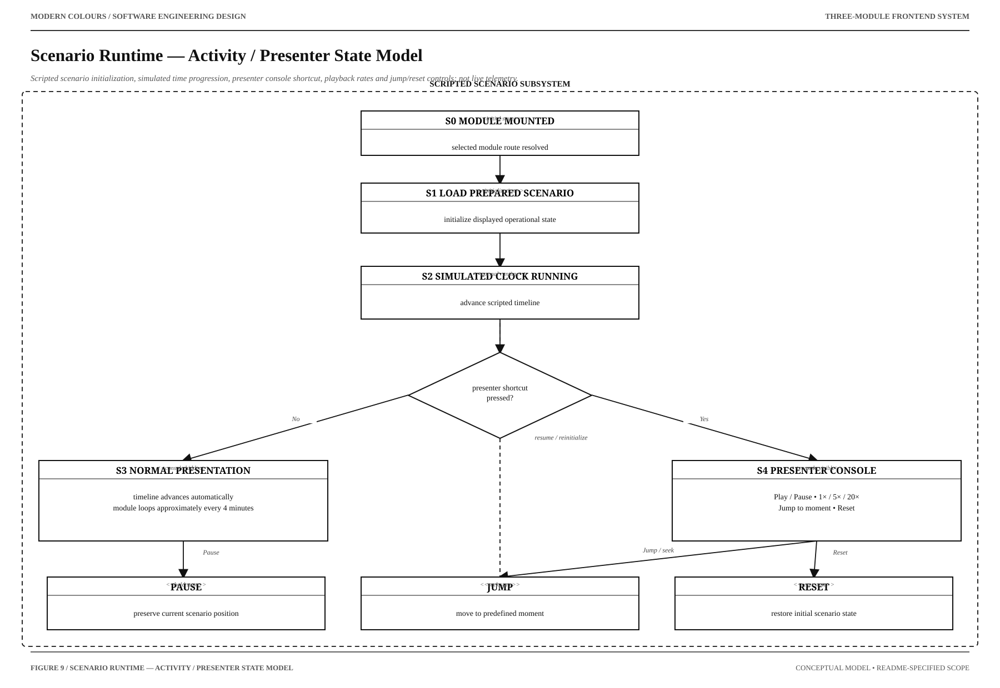
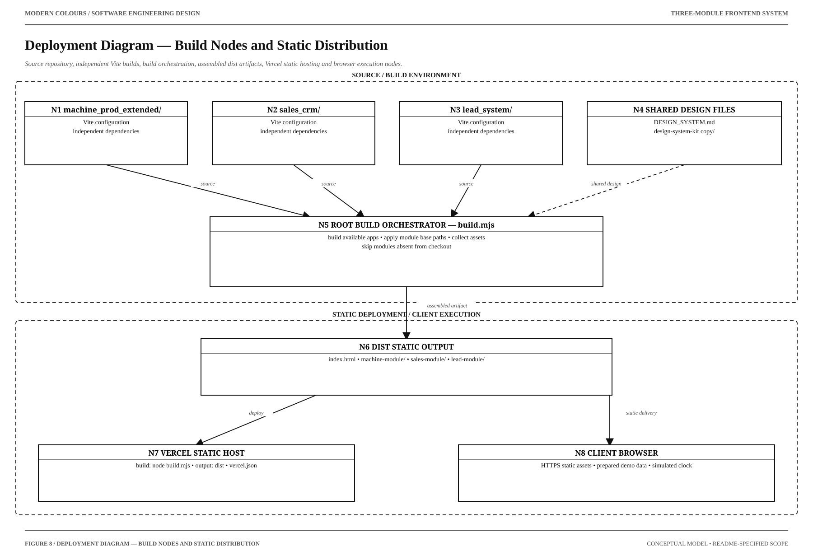

# MODERN COLOURS

<p align="center">
  
</p>

<h3 align="center">Intelligent Manufacturing. Connected Operations.</h3>

<p align="center">
  A unified digital operations experience for production, sales and business development
</p>

<p align="center">
  
  
  
  
</p>

<p align="center">
  <strong>PRODUCTION INTELLIGENCE · SALES OPERATIONS · LEAD INTELLIGENCE</strong>
</p>

---

## Contents

- [1. Platform overview](#1-platform-overview)
- [2. The three applications](#2-the-three-applications)
- [3. System architecture](#3-system-architecture)
- [4. Shared design system](#4-shared-design-system)
- [5. Shared business conventions](#5-shared-business-conventions)
- [6. Scenario engine and presenter console](#6-scenario-engine-and-presenter-console)
- [7. Build and deployment architecture](#7-build-and-deployment-architecture)
- [8. Local development](#8-local-development)
- [9. Operational and integration boundaries](#9-operational-and-integration-boundaries)
- [10. Architecture diagrams](#10-architecture-diagrams)
- [11. Repository layout and implementation status](#11-repository-layout-and-implementation-status)
- [12. Legacy diagrams](#12-legacy-diagrams)

---

## 1. Platform overview

**Modern Colours** is a unified digital operations experience designed to connect three important areas of a manufacturing business: factory-floor visibility, customer and order operations, and business development.

Rather than combining every workflow into a single monolithic interface, the platform is organized as three focused frontend applications. Each application owns a specialist workspace while following one shared design language and common business-reference conventions.

| Application | Route | Project directory | Operational focus |
|---|---|---|---|
| **Production & Machine** | `/machine-module` | `machine_prod_extended/` | Production visibility, machine operations, operator workspaces and batch tracking |
| **Sales & Order Management** | `/sales-module` | `sales_crm/` | Customer relationships, sales pipeline and order lifecycle |
| **Lead Intelligence** | `/lead-module` | `lead_system/` | Lead management, prospect tracking and business-development workflows |

**Deployment principle:** one repository, three independently structured applications, one assembled deployment.

## 2. The three applications

### 2.1 Production & Machine

<sub>Application directory: `machine_prod_extended/` · route: `/machine-module`</sub>

The Production & Machine workspace is designed around factory-floor visibility and machine-related operational information.

- Production monitoring interface and operational status views.
- Machine-level workspaces for inspecting machine activity.
- Operator-specific entry contexts.
- Batch and production tracking, using shared batch references.
- Time-driven scripted scenarios for repeatable walkthroughs.

An example of contextual entry is:

```text
/machine-module/?as=U-106
```

The `as` query parameter opens the module in a predefined user context for demonstration and navigation purposes.

### 2.2 Sales & Order Management

<sub>Application directory: `sales_crm/` · route: `/sales-module`</sub>

The Sales & Order Management workspace structures the commercial side of the operating environment.

- Customer relationship views and customer-specific workspaces.
- Sales pipeline visibility.
- Order lifecycle management and status presentation.
- Unified product references.
- Shared raw-material references.
- Consistent customer, geography, currency and date conventions.

### 2.3 Lead Intelligence

<sub>Application directory: `lead_system/` · route: `/lead-module`</sub>

The Lead Intelligence workspace focuses on business-development activity and prospective opportunities.

- Lead and prospect management.
- Structured lead information.
- Business-development workflows.
- Lead intelligence views.
- Sales opportunity visibility and follow-up context.

The project description defines these as focused frontend workflows; it does not specify a live external CRM or lead-enrichment service.

## 3. System architecture

Modern Colours uses a **modular frontend architecture**. Each application can be developed and built independently, then assembled into a single deployment output.

<p align="center">
  
</p>

### 3.1 Application boundaries

| Boundary | Responsibility |
|---|---|
| Landing page | Central entry point and navigation to the three application routes |
| Production & Machine | Production monitoring, machine workspaces, operator context and batch views |
| Sales & Order Management | Customer relationship, pipeline and order lifecycle views |
| Lead Intelligence | Lead records, prospect tracking and opportunity workflows |
| Shared design resources | Common UI language, reusable patterns and design specifications |
| Prepared scenario data | Repeatable seeded states used by the demonstration timelines |
| Root build orchestrator | Builds available applications and assembles the deployment output |

<p align="center">
  
</p>

### 3.2 Module-level architecture

**Production & Machine**

<p align="center">
  
</p>

**Sales & Order Management**

<p align="center">
  
</p>

**Lead Intelligence**

<p align="center">
  
</p>

## 4. Shared design system

All three modules consume a common design language so that users experience one coherent platform rather than three unrelated products.

The shared design resources are documented in:

- `DESIGN_SYSTEM.md` — the central design specification.
- `design-system-kit copy/` — shared design and component references.

The common design system covers:

| Design dimension | Shared convention |
|---|---|
| Colour architecture | Consistent semantic and brand colour usage |
| Typography | Shared hierarchy and text treatment |
| Spacing | Standardized layout and component spacing |
| Elevation | Consistent surfaces, borders and shadows |
| Components | Reusable interface patterns |
| Motion | Common transitions and interaction feedback |
| Responsiveness | Consistent behaviour across viewport sizes |

<p align="center">
  
</p>

Individual modules may have different operational layouts, but they should not redefine shared tokens and foundations independently.

## 5. Shared business conventions

The project specification defines shared reference conventions across the three modules. These keep names, quantities and contextual information consistent when users move between application workspaces.

| Data area | Shared convention |
|---|---|
| Customers | Eight common customer records |
| Products | Unified product references |
| Raw materials | Shared raw-material references |
| Geography | Consistent city references |
| Production batches | `B-2280` through `B-2299` |
| Currency | Indian Rupee (₹) |
| Number formatting | Indian numbering conventions |
| Date formatting | `DD MMM YYYY` |

<p align="center">
  
</p>

**Data-model clarification:** these are shared business-reference conventions from the project specification. They do not, by themselves, imply a shared database, live API, foreign-key model or real-time synchronization between the three frontends.

## 6. Scenario engine and presenter console

The platform includes a scripted operational timeline to demonstrate how interface states evolve. A **simulated clock** drives prepared scenarios so that walkthroughs are repeatable without connecting to live factory systems.

### 6.1 Presenter console

The presenter console is hidden during the normal application experience.

**Keyboard shortcut:** `Ctrl + Shift + D`

| Control | Behaviour |
|---|---|
| Play / Pause | Starts or pauses the scripted timeline |
| 1× | Normal playback |
| 5× | Accelerated playback |
| 20× | Fast-forward playback |
| Jump | Moves to predefined moments |
| Reset | Returns the scenario to its initial state |

### 6.2 Continuous operation

Each module is described as cycling through its prepared operational timeline approximately every four minutes. This supports unattended screens, demonstrations and continuous product walkthroughs.

### 6.3 Contextual user entry

Modules support predefined user contexts through URL parameters. For example:

```text
/machine-module/?as=U-106
```

<p align="center">
  
</p>

## 7. Build and deployment architecture

Each module maintains its own Vite configuration, dependencies and application structure. The root `build.mjs` script orchestrates the unified output.

### 7.1 Build sequence

1. Discover and build each available application.
2. Apply the module-specific base path.
3. Collect the generated application assets.
4. Assemble the modules and central landing page into one `dist/` directory.
5. Skip a module if its project directory is not present in the checkout.

<p align="center">
  
</p>

### 7.2 Deployment configuration

The documented Vercel configuration is:

| Setting | Value |
|---|---|
| Build command | `node build.mjs` |
| Output directory | `dist` |
| Install command | `npm install --no-audit --no-fund` |
| Deployment configuration | `vercel.json` |

The assembled output is expected to contain:

```text
dist/
├── index.html
├── machine-module/
├── sales-module/
└── lead-module/
```

This is a static frontend deployment model. The diagram does not represent a backend API tier or a live connection to the factory's ERP.

## 8. Local development

### Requirements

- Node.js
- npm
- Git

### Run Production & Machine

```bash
npm run dev:machine
```

Open `http://localhost:5173/machine-module/`.

### Run Sales & Order Management

```bash
npm run dev:sales
```

Open `http://localhost:5173/sales-module/`.

### Run Lead Intelligence

```bash
npm run dev:leads
```

Open `http://localhost:5173/lead-module/`.

The documented module commands start each Vite application independently. On first execution, the corresponding module's dependencies are installed.

### Build the complete platform

From the repository root:

```bash
node build.mjs
```

The combined production bundle is generated in `dist/`.

## 9. Operational and integration boundaries

The current product description defines a self-contained demonstration environment.

| Area | Current scope described |
|---|---|
| Data | Prepared seed/reference data |
| Clock | Simulated operational time |
| Scenarios | Scripted and repeatable interface states |
| ERP integration | No live ERP connection established |
| Production data | No live production database connection established |
| Authentication | No connection to the factory's live authentication infrastructure established |
| Backend services | No external backend service dependency established by the described frontend environment |
| Operational impact | The demo environment does not write to or modify real factory operations |

The distinction matters: Modern Colours presents a connected operational experience, but the current demonstration environment is isolated from the live production ERP.

## 10. Architecture diagrams

The complete **nine-diagram current architecture set** is in [`docs/diagrams/current/`](docs/diagrams/current/README.md). Expand the links below to inspect each source SVG.

<details>
<summary><strong>Current diagram register (9 diagrams)</strong></summary>

1. [Platform context](docs/diagrams/current/platform-context.svg) — Landing page, three module routes, shared design language and business conventions.
2. [Modular application architecture](docs/diagrams/current/module-architecture.svg) — Three separate Vite apps, each retaining its own project configuration and dependencies.
3. [Production & Machine module](docs/diagrams/current/production-machine.svg) — Production visibility, machine workspaces, operator context and batch-oriented scenarios.
4. [Sales & Order Management module](docs/diagrams/current/sales-order-management.svg) — Customer views, sales pipeline, order lifecycle and shared product/material references.
5. [Lead Intelligence module](docs/diagrams/current/lead-intelligence.svg) — Lead and prospect management, business-development workflows and opportunity views.
6. [Shared design-system architecture](docs/diagrams/current/shared-design-system.svg) — Central design specification and component references consumed by all three applications.
7. [Shared business reference model](docs/diagrams/current/shared-business-data.svg) — Common customer, product, raw material, geography, batch and formatting conventions.
8. [Unified build and deployment](docs/diagrams/current/build-and-deployment.svg) — Independent module builds assembled into one Vercel deployment by build.mjs.
9. [Scenario timeline and presenter controls](docs/diagrams/current/scenario-timeline.svg) — Simulated clock, repeated scenario playback, hidden presenter console and user-context entry.

</details>

The diagram library also contains an explicit archive for the diagrams from earlier project versions. See [Legacy diagrams](#12-legacy-diagrams).

## 11. Repository layout and implementation status

### 11.1 Target module layout

The three-app project layout described by this architecture is:

```text
SE_project/
├── machine_prod_extended/     # Production & Machine Vite app
├── sales_crm/                 # Sales & Order Management Vite app
├── lead_system/               # Lead Intelligence Vite app
├── design-system-kit copy/    # Shared design and component references
├── DESIGN_SYSTEM.md           # Shared design specification
├── build.mjs                  # Unified build orchestrator
├── vercel.json                # Vercel build/output/routing config
├── mark.svg                   # Brand mark
├── docs/
│   └── diagrams/
│       ├── current/            # Current three-module architecture
│       └── old/                # Archived diagrams; not current
└── README.md
```

### 11.2 Snapshot verification note

The architecture documented here follows the three-module Modern Colours project specification. In the GitHub `main` snapshot inspected while preparing this update, the directories `machine_prod_extended/`, `sales_crm/` and `lead_system/` were **not present**; the visible source tree instead contained the earlier `frontend/` and `backend/` portal implementation. The diagrams therefore document the specified three-app target architecture and must not be read as proof that those three application directories or their build pipeline are already present in the inspected snapshot.

The legacy diagram archive preserves prior project documentation for traceability. It is not part of the current architecture.

## 12. Legacy diagrams

> **OLD — ARCHIVED**

The following assets are retained as historical references only:

- [Old diagram archive index](docs/diagrams/old/README.md)
- [Old project UML, DFD, sequence and workflow diagrams](docs/diagrams/old/legacy-project/)
- [Old Admin / Dealer / Customer portal architecture diagrams](docs/diagrams/old/previous-portal-architecture/)

Use only the diagrams in [`docs/diagrams/current/`](docs/diagrams/current/README.md) when presenting or extending the three-module Modern Colours architecture.

---

<p align="center">
  
  <br />
  <strong>MODERN COLOURS</strong>
  <br />
  Intelligent Manufacturing. Connected Operations.
  <br /><br />
  <sub>Production intelligence · Sales operations · Lead intelligence</sub>
</p>
